# 00: Dukkan Firebase Backend, Read Me First

This folder is the backend plan for Dukkan. It covers every Firestore collection, every field, the security rules, the indexes, the Cloud Functions, push notifications, Storage, and how each screen in the Figma file uses them.

It is based on:

- the Figma file **Dukkan App** (latest revision): *Customer app* (sections 01–14 incl. 02b email verification, 05b search, 07b coupons & brands, 10b order problems, 11b account extras, 13 dark & Arabic, 14 empty & loading) and *Team app · Picker & Courier* (S01, S02, F01, F02, F03, C01, C02, C03);
- the auth work already done in [../auth/auth_feature_implementation_guide.md](../auth/auth_feature_implementation_guide.md) (`users/{uid}`, `users/{uid}/devices/{installationId}`, the error architecture, MVI).

> **This folder supersedes sections 3.2 (Firestore rules) and 4 (users/devices schema) of the auth guide.**
> Every field the auth guide created keeps its name and meaning. We only **add** fields and collections.
> When you reach the rules step, use [07_security_rules.md](07_security_rules.md) instead of the auth guide's rules.

---

## 1. Two apps, one Firebase project

| App | Who uses it | Where the code lives | Figma page |
|---|---|---|---|
| **Dukkan** (customer) | shoppers | this repo, module `:app`, package `com.example.dukkanapp` | *Customer app* |
| **Dukkan Team** (staff) | **pickers** in the dark store, **couriers** | a second app module later (`:team`), same Firebase project | *Team app · Picker & Courier* |

The team app is **one app with two roles**. After sign-in, the user's role (a Firebase Auth *custom claim*, `picker` or `courier`) decides which flow opens: picker (S01.4 → F01/F02/F03) or courier (S01.3 → C01/C02/C03). Nobody picks their own role. See [06_team_collections.md](06_team_collections.md).

**Why one project for both apps:** orders are shared. The customer places `orders/{id}`, the picker packs it, the courier delivers it. With two projects you would need a sync service between them. With one project, security rules decide who sees what.

---

## 2. Firebase products we use, and why

| Product | Used for | Why this and not something else |
|---|---|---|
| **Authentication** | Customer: Email/Password (done), Google, Facebook (Figma 02.1/02.2). Staff: Email/Password only (invited work email) | Free, handles password reset (02.4), email verification, and **custom claims** for staff roles |
| **Cloud Firestore** | All app data: catalog, carts, orders, staff, couriers | Real-time listeners for order tracking and courier offers, offline cache (Figma 12.4 says "Firestore offline cache is on") |
| **Cloud Storage** | Avatars, product photos, packing photos (F02.1), door photos (C02.4), address voice notes (03.3) | Large binary files do not belong in Firestore (1 MiB document limit) |
| **Cloud Messaging (FCM)** | Order status pushes, "courier 2 min away", flash deals, price drops, new courier offers, "order ready" | The only free push service on Android |
| **Cloud Functions (2nd gen, TypeScript)** | Placing orders, prices, coupons, stock, order numbers, status changes, dispatch, counters, pushes | **The client must never decide money, stock, or status.** A modified APK can write anything the rules allow, so these writes happen on the server |
| **Firebase Installations** | Device id for `users/{uid}/devices/{installationId}` | Already used by the auth feature |
| **App Check (Play Integrity)** | Blocks calls that don't come from our signed APK | Stops scripts from calling `placeOrder` or scraping the catalog with a stolen API key |
| *Crashlytics* (optional) | Crash reports | Plugs into `ErrorReporter` |
| *Analytics* (optional) | Funnels (onboarding → sign-up → first order) | Free, no extra setup |
| *Remote Config* (optional) | Feature flags, minimum app version, free-delivery threshold shown in the UI | Change a value without shipping an update. The server still enforces the real rule |

### Pieces that are NOT Firebase

| Need | Tool | Screens |
|---|---|---|
| Map, pin drop, reverse geocoding, address search | **Google Maps SDK for Android + Places SDK** (`maps-compose`) | 03.1, 03.2, 03.6, 10.3, C02.1, C02.3 |
| Turn-by-turn directions for couriers | Open Google Maps with an intent (`google.navigation:q=lat,lng`). Building our own navigation is out of scope | C02.1, C02.3 |
| Card payments | **Konnect** (decided). It's Tunisian, settles in TND, and accepts local bank cards, e-DINAR and international cards. v1 ships **cash on delivery + Dukkan wallet**; cards come next. We store only Konnect's token, brand and last 4 digits | 09.2, 11.1 "Payment methods" |
| Full-text product search ("Search 12,000+ products") | **Algolia** (decided), synced by the official Firebase extension. Firestore cannot do "contains" text search. See [14_search_algolia.md](14_search_algolia.md) | 04.1, 05.1, search results |
| Barcode / QR scanning | **ML Kit Barcode Scanning** + CameraX (on-device, free) | F01.3, C02.2 |
| Recent searches, recently viewed, theme (light/dark/system), language | **DataStore** on the phone (already used for language and Remember Me) | 03.1, 05b.1, 11.3 |
| "Your courier is at the door" message (Figma says "SMS") | **WhatsApp Business Platform, Cloud API (Meta)** (decided): a pre-approved template `courier_at_door` (ar/fr/en) sent by `reportIssue`; token in a Functions secret; only with `users/{uid}.whatsappOptIn`; push-only fallback ([09 § 8c](09_cloud_functions.md#8c-whatsapp-courier-at-your-door-message-c032)) | C03.2, 10.7 |
| Team app offline queue for callables | **Room + WorkManager** outbox ([13 § 7b](13_android_integration.md#7b-team-app-outbox-offline-callables-s023)) | S02.3 |
| "Chat with us" (v1) | WhatsApp / email intent | 11.7 |

---

## 3. Reading order

| # | File | What you get |
|---|---|---|
| 00 | this file | Big picture and the entity diagram |
| 01 | [01_project_setup.md](01_project_setup.md) | Console steps, Gradle, CLI, emulators |
| 02 | [02_data_modeling_rules.md](02_data_modeling_rules.md) | **Read before any collection.** Money, ids, time, i18n, and where copies are allowed |
| 03 | [03_catalog_collections.md](03_catalog_collections.md) | zones, stores, inventory, categories, brands (A–Z), products, variants, banners, collections, reviews, coupons (`minTier`), help center |
| 04 | [04_customer_collections.md](04_customer_collections.md) | users (extended), addresses, devices, favorites, cart (+ points), inbox, **wallets**, payment methods, coupons, **referrals** |
| 05 | [05_order_collections.md](05_order_collections.md) | orders, items, events, bags (`shortCode`), **issues**, handover codes, rating/tip, status machine (cancel, delivery failed, store pickup), live tracking |
| 06 | [06_team_collections.md](06_team_collections.md) | staff, claims, couriers, location, offers, shifts, stats, earnings, payouts, cash deposits, manual barcode, sign-out guard, offline |
| 07 | [07_security_rules.md](07_security_rules.md) | Complete `firestore.rules` + `storage.rules` + emulator tests |
| 08 | [08_queries_and_indexes.md](08_queries_and_indexes.md) | The query behind every list screen + `firestore.indexes.json` |
| 09 | [09_cloud_functions.md](09_cloud_functions.md) | Every function, with TypeScript for the important ones |
| 10 | [10_fcm_push_notifications.md](10_fcm_push_notifications.md) | Tokens, permission, channels, payloads, the Kotlin service |
| 11 | [11_storage.md](11_storage.md) | Paths, limits, rules, upload code |
| 12 | [12_screen_to_firebase_map.md](12_screen_to_firebase_map.md) | Every screen → reads / writes / functions / pushes |
| 13 | [13_android_integration.md](13_android_integration.md) | Clean architecture + MVI wiring, Hilt, build order |
| 14 | [14_search_algolia.md](14_search_algolia.md) | Product search: Algolia extension, index settings, `searchProducts` function, Android search feature |

### Decisions taken (2026-10-29)

| Topic | Decision |
|---|---|
| Sign-in providers | Follow Figma: **Google + Facebook** + email (both social logins still TODO). Apple is dropped |
| Guest browsing | **Not allowed.** Home and the catalog need a signed-in account (rules in 07) |
| Multi-stop runs | **Yes**, at most 2 orders per run, both from the same store (09 § 6) |
| Search | **Algolia** (14) |
| Card payments | **Konnect**, after v1 (cash on delivery + wallet first) |
| Dark mode | Our proposed dark palette until the designer delivers one |

### Decisions taken with the Figma revision (2026-10-29, later)

| Topic | Decision | Where |
|---|---|---|
| Wishlist path | Renamed to `users/{uid}/favorites` (Figma map) | 04 § 4 |
| Money and points | Moved out of `users/{uid}` into a function-only `wallets/{uid}` + `transactions` + `pointsLedger` | 04 § 7 |
| Points value | 100 points = 1 TND (1 point = 10 millimes); the cart holds `pointsToUse` | 04 § 5 |
| Customer cancel | Only while `placed` ("before packing started"); wallet refunds are instant | 05 § 5, 09 § 8b |
| Delivery failed | 5-min door wait → `returning` → `failed` → customer chooses redeliver / store pickup / cancel within 24 h | 05 § 4c, § 5 |
| Problem reports | `orders/{id}/issues`, written by `reportIssue` | 05 § 4b |
| Referrals | `referrals/{code}` + `invites`, rewards via the wallet | 04 § 10 |
| Payouts | Kept as `couriers/{uid}/payouts/{weekId}` (history) | 06 § 3 |
| Team offline | Room + WorkManager outbox, idempotent callables (`requestId`) | 06 § 8b, 13 § 7b |

### Decisions taken with Figma round 3 (2026-10-29)

| Topic | Decision | Where |
|---|---|---|
| "SMS" provider | **WhatsApp** (Meta WhatsApp Business Platform, Cloud API, template messages). Figma copy still says "SMS" (C03.2, 10.7) | 09 § 8c, 10 |
| Customer tiers | **Total spend** on delivered orders in the last 12 months: Member < 500 TND, Silver ≥ 500 TND, Gold ≥ 1,500 TND; thresholds in `config/tiers`; up at once on delivery, down only in the nightly job | 04 § 1, 09 § 8d |
| Redelivery slots | 1-hour slots from the store's opening hours, ≥ 60 min ahead, today (else tomorrow), capacity per slot (`stores/{id}/slotLoad`), callable `getRedeliverySlots` | 03 § 2, 05 § 5, 09 § 8b |
| Cancel and coupons | A cancelled order gives a **still-valid** coupon back (10.6 "FREESHIP is back in My coupons"); expired coupons are not restored | 05 § 5.3, 09 § 8b |

---

## 4. Entity diagram

`||--o{` means "one to many". **Bold** labels are subcollections. Arrows that say *ref* are ids stored in a field.

```mermaid
erDiagram
    USERS ||--o{ DEVICES : "devices"
    USERS ||--o{ ADDRESSES : "addresses"
    USERS ||--o{ FAVORITES : "favorites"
    USERS ||--o{ NOTIFICATIONS : "notifications"
    USERS ||--|| WALLETS : "wallets/{uid}"
    WALLETS ||--o{ POINTS_LEDGER : "pointsLedger"
    WALLETS ||--o{ WALLET_TX : "transactions"
    USERS ||--|| REFERRALS : "referralCode ref"
    REFERRALS ||--o{ INVITES : "invites"
    USERS ||--o{ PAYMENT_METHODS : "paymentMethods"
    USERS ||--o{ USER_COUPONS : "coupons"
    USERS ||--o{ FOLLOWED_BRANDS : "followedBrands"
    USERS ||--o{ STOCK_ALERTS : "stockAlerts"
    USERS ||--|| CARTS : "carts/{uid}"
    CARTS ||--o{ CART_ITEMS : "items"

    ZONES }o--|| STORES : "storeId ref"
    STORES ||--o{ INVENTORY : "inventory"
    STORES ||--o{ SLOT_LOAD : "slotLoad (redelivery capacity)"
    CATEGORIES ||--o{ CATEGORIES : "parentId ref"
    BRANDS ||--o{ PRODUCTS : "brandId ref"
    CATEGORIES ||--o{ PRODUCTS : "categoryPath ref"
    PRODUCTS ||--o{ VARIANTS : "variants"
    PRODUCTS ||--o{ REVIEWS : "reviews"
    INVENTORY }o--|| VARIANTS : "doc id = variantId"
    COLLECTIONS }o--o{ PRODUCTS : "productIds ref"
    BANNERS }o--o| COLLECTIONS : "target ref"
    COUPONS ||--o{ REDEMPTIONS : "redemptions"

    USERS ||--o{ ORDERS : "customerId ref"
    STORES ||--o{ ORDERS : "storeId ref"
    ORDERS ||--o{ ORDER_ITEMS : "items"
    ORDERS ||--o{ ORDER_EVENTS : "events"
    ORDERS ||--o{ BAGS : "bags"
    ORDERS ||--o{ ISSUES : "issues"
    ORDERS ||--o{ ORDER_PRIVATE : "private (codes)"
    HELP_TOPICS ||--o{ HELP_ARTICLES : "topicId ref"
    CASH_DEPOSITS }o--|| COURIERS : "courierId ref"

    STAFF ||--o| COURIERS : "same uid"
    COURIERS ||--|| COURIER_LOCATIONS : "courierLocations/{uid}"
    COURIERS ||--o{ EARNINGS : "earnings"
    COURIERS ||--o{ PAYOUTS : "payouts"
    STAFF ||--o{ DAILY_STATS : "dailyStats"
    STAFF ||--o{ SHIFTS : "staffId ref"
    DISPATCH_OFFERS }o--|| ORDERS : "orderId ref"
    DISPATCH_OFFERS }o--|| COURIERS : "courierId ref"
    ORDERS }o--o| COURIERS : "courierId ref"
    ORDERS }o--o| STAFF : "pickerId ref"
```

### Top-level collections at a glance

| Collection | One document is | Client writes? |
|---|---|---|
| `users` | a customer | yes, own profile fields only |
| `wallets` | one customer's wallet + points balance (id = uid) | **no** (functions) |
| `referrals` | an invite code and its counters (id = code) | **no** (functions) |
| `carts` | one customer's cart (id = uid) | yes, own cart |
| `zones` | a delivery area polygon | no (admin) |
| `stores` | a dark store / hub | no (admin) |
| `categories`, `brands`, `products`, `banners`, `collections` | catalog | no (admin) |
| `coupons` | a promo code and its rules | no (admin) |
| `orders` | one order | **no**: functions only, plus picker item updates |
| `staff` | a team member | no (functions) |
| `couriers` | a courier's live status | yes, the courier's own status fields |
| `courierLocations` | a courier's last GPS point | yes, the courier's own position |
| `dispatchOffers` | a delivery offer to one courier | no (functions) |
| `shifts` | a planned or worked shift | no (manager / functions) |
| `cashDeposits` | cash a courier returned at the hub | no (manager callable) |
| `helpTopics`, `helpArticles` | help center content (11.7) | no (admin) |
| `zoneWaitlist` | "notify me when you arrive" (03.6) | create only |
| `counters` | order-number counter | no (functions) |
| `config` | app-wide settings, e.g. `config/tiers` (tier thresholds) | no (admin); read by signed-in users |

---

## 5. The three rules that shape everything

1. **One fact, one home.** Every value has exactly one document that owns it. Copies are allowed only when listed in [02 § 4](02_data_modeling_rules.md#4-intentional-denormalization-the-only-copies-allowed), and each listed copy has a named writer.
2. **Money, stock and status are written by the server.** The client asks with a callable function. The function checks and writes. Rules forbid the client from writing these fields.
3. **Rules are the real API.** If a rule allows a write, assume a hacked app will do it. Every client-writable document has a `hasOnly([...])` field whitelist.

---

## 6. Figma Firebase map vs our schema

The Figma covers now include a "Firebase map". Here is how each name maps to this doc set, and why where we differ.

| Figma map | Our schema | Decision and why |
|---|---|---|
| `users/{uid}` profile, settings, fcmToken | `users/{uid}` + `users/{uid}/devices/{installationId}.fcmToken` | Same, except the token: one per **device**, not per user (auth guide § 4.2) |
| `users/{uid}/addresses` | same | Same |
| `users/{uid}/favorites` (11b note says `favorites/{uid}`) | `users/{uid}/favorites/{productId}` | **Adopted** (was `wishlist`). The cover's path keeps everything personal under the user |
| `categories · brands`, `products/{id}`, `banners · collections` | same | Same |
| Algolia index | `products` index + replicas + query suggestions (14) | Same |
| `carts/{uid}` items, coupon, points | `carts/{uid}` + `items` + `couponCode` + `pointsToUse` | **Adopted** (`pointsToUse` added) |
| `coupons/{code}` | same + `users/{uid}/coupons` | Same; the per-user pocket drives "My coupons" tabs |
| `orders/{id}` status, courier, timeline, issues | `orders/{id}` + `events` + `issues` | **Adopted** `issues` subcollection |
| `wallets/{uid}` balance, refunds, points | `wallets/{uid}` + `transactions` + `pointsLedger` | **Adopted**: separates server-owned money from the client-editable profile |
| `referrals/{code}` | `referrals/{code}` + `invites` | **Adopted** |
| Team: Auth custom claims `role: picker \| courier` | same (+ `storeId`) | Same. Figma S01 now also says "role from custom claims"; `staff/{uid}` stays the editable record (06 § 1) |
| `orders/{id}/items` picked, swapped, missing | same | Same |
| `bags/{id}` | `orders/{id}/bags/{bagId}` | **Kept ours**: a bag never exists without its order; the QR holds the order id |
| `offers/{courierId}` | `dispatchOffers/{offerId}` | **Kept ours**: one courier gets many offers; one doc per courier would lose history and race |
| `couriers/{id}/location` | `courierLocations/{courierId}` | **Kept ours**: one doc, simple listener and `visibleTo` rule |
| `payouts/{courierId}` | `couriers/{uid}/payouts/{weekId}` | **Kept ours**: C03.4 shows a weekly **history**; one doc per courier can't |

---

## 7. Check

- [ ] You understand which app owns which flow (customer vs picker vs courier).
- [ ] You know which tools are not Firebase (Maps, payments, search, ML Kit).
- [ ] You read file 02 before creating any collection.
- [ ] You use [07_security_rules.md](07_security_rules.md), not the auth guide's rules.
